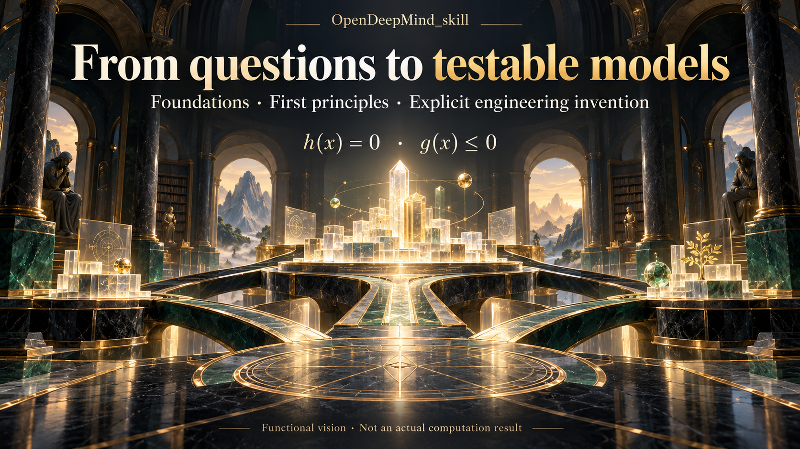
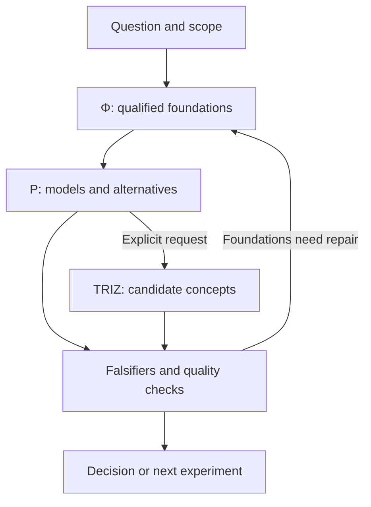

# OpenDeepMind_skill


**Qualify foundations, build explicit models, and make conclusions testable.**

[简体中文](README.zh-CN.md) · [Runtime router](open-deep-mind/SKILL.md) · [Architecture](open-deep-mind/ARCHITECTURE.md) · [Module registry](open-deep-mind/MODULES.json) · [Benchmark](BENCHMARK.md)



*Concept artwork. The physical forms and mathematical motifs illustrate the workflow; they are not measured data or an executed simulation.*

OpenDeepMind is a portable Agent Skill with three isolated reasoning modules and a separate evaluation layer. Its Python tools validate structured claims, module contracts and benchmark artifacts. They do not include a language-model service, electronic-structure solver, experimental instrument or automatic scientific certification.

This is an independent project, without affiliation with or endorsement by Google DeepMind, OpenAI, Anthropic, MATRIZ, the Altshuller Institute or the maintainers of referenced repositories. Version and licensing are recorded in [VERSION](VERSION), [LICENSE.md](LICENSE.md) and [NOTICE.md](NOTICE.md).

## 1. What the repository actually does

| Component | Input and responsibility | Output / entrypoint |
|---|---|---|
| First Philosophy, Φ8 | Examine definitions, evidence, causality, boundary, scale and values | [Foundation Charter and Φ0–Φ7](open-deep-mind/first-philosophy/METHOD.md) |
| First Principles, P9 | Decompose requirements; distinguish laws, constraints and assumptions; construct and challenge models | [Model and decision contracts, P1–P9](open-deep-mind/first-principles/METHOD.md) |
| TRIZ, T10 | Generate engineering concepts when explicitly requested or accepted | [T1–T10 router](open-deep-mind/triz/ROUTER.md); concepts return to P for validation |
| Claim ledger | Check fields, typed references, inference structure and cycles | [validate_ledger.py](open-deep-mind/scripts/validate_ledger.py) |
| Evaluation framework | Create isolated iterations; check run identity and grading consistency; aggregate comparable records | [Evaluation scripts](open-deep-mind/evals/scripts/) |
| Software validation | Check module manifests, links, schemas, fixtures and regression behavior | [CI workflow](.github/workflows/validate.yml) |

The core Python validators use the standard library. The host agent/model is supplied by your Agent-Skills-compatible runtime. The evaluation folder is an observation layer and is never loaded as a fourth reasoning method.



## 2. Start from a concrete question

Clone the repository, then expose the `open-deep-mind/` folder to your runtime's skill discovery mechanism. Load [SKILL.md](open-deep-mind/SKILL.md) as the router; do not paste the entire evaluation dataset into the agent's instructions.

```bash
git clone https://github.com/SUNHAOJUN22/OpenDeepMind_skill.git
cd OpenDeepMind_skill
python open-deep-mind/scripts/validate_repository.py .
python open-deep-mind/scripts/validate_ledger.py open-deep-mind/assets/example-ledger.json
```

The CI uses Python 3.12. Start a task with an operational outcome, rather than a preferred technology:

```text
Question: Which proposed mechanism best explains the observed trend?
Decision: Select the next discriminating calculation or experiment.
Boundary: State the system, time scale and conditions.
Evidence: Link raw observations, units, uncertainty and provenance.
Constraints: State limits and who can revise them.
Unknowns: List what could change the decision.
Request: Use Φ to qualify the framing, then P to compare rival models.
        Separate observations, assumptions and empirical closures.
        Give a falsifier and a reversible next step.
```

For a well-framed engineering task, load P directly. Use Φ first when the meaning of the target, evidence standard, causal claim or objective is uncertain. TRIZ requires explicit activation; the mere presence of a trade-off does not activate it. A useful TRIZ instruction is: “Explicitly use TRIZ to propose candidate mechanisms, then return each candidate to physical and evidential checks.”

## 3. Typed claims and traceability

The canonical vocabulary is `D/O/L/C/A/E/V/U`, defined in the [claim schema](open-deep-mind/assets/claim-ledger.schema.json). The compatibility API accepts the codes or corresponding full names. In particular, **C means constraint** and **E means empirical closure**.

| Code | Type | Required interpretation |
|---|---|---|
| D | Definition | An explicit meaning or operational definition |
| O | Observation | A sourced measurement or recorded observation |
| L | Law / invariant | An independently supported relation within its domain |
| C | Constraint | A declared boundary or requirement, with authority and scope |
| A | Assumption | A revisable premise with a sensitivity or falsification condition |
| E | Empirical closure / estimate | A fitted, heuristic or learned relation with provenance |
| V | Value | A stakeholder objective, preference or normative commitment |
| U | Unknown | A gap that may affect the next decision |

A ledger can be represented as a directed graph $G=(N,E)$, with edges linking premises, inferences and conclusions. A valid reference must name an existing node, and circular support cannot establish a conclusion:

$$
\forall (u,v)\in E,\quad u,v\in N,\qquad G\text{ must be acyclic}.
$$

The validator uses iterative graph traversal with a raw-input budget of 8 MiB, 10,000 records and 100,000 references. JSON nesting is limited to 128 levels. Duplicate JSON keys, non-finite JSON numbers and unpaired Unicode surrogates are rejected. Ledger and benchmark JSON readers also reject nonzero numbers that underflow to zero during floating-point conversion: a negative confidence or judge score such as `-1e-999` cannot become an accepted zero. Exact zero significands such as `0e-999` and representable subnormal values such as `5e-324` remain valid numeric inputs, subject to each field's range. These are software resource and consistency checks, not proof that the recorded claims are true.

Where confidence is supplied, it is a finite, non-Boolean number:

$$
0\le c_i\le1.
$$

Do not interpret a confidence label as a calibrated probability unless a calibration procedure and relevant data support that interpretation.

## 4. Mathematical model contracts

P's [model contract](open-deep-mind/first-principles/model-contract.schema.json) asks for the purpose, variables, parameters, provenance, governing relations, initial/boundary conditions, closure assumptions, observation/error model, validity domain and falsifiers. The following equations describe supported **reasoning templates**; the repository does not numerically solve them.

### Feasibility and objectives

$$
\mathcal X_f=\{x\mid h(x)=0,\;g(x)\le0\},\qquad
x^\star\in\operatorname*{arg\,min}_{x\in\mathcal X_f}J(x;V).
$$

Here $x$ is the decision vector, $h$ equality constraints, $g$ inequality constraints, $J$ the objective and $V$ the explicit value commitments. An optimum is meaningful only after the feasible set and objective are justified. Alternatives that violate a hard constraint are excluded before preference scoring.

### Dynamics, conservation and observation

$$
\dot{\mathbf x}=\mathbf f(\mathbf x,\mathbf u,\boldsymbol\theta,t),\qquad
\frac{\partial q}{\partial t}+\nabla\cdot\mathbf J_q=s_q.
$$

States $\mathbf x$, controls $\mathbf u$, parameters $\boldsymbol\theta$, conserved density $q$, flux $\mathbf J_q$ and source $s_q$ require units and a validity domain. Relate the model to measurement through an observation operator:

$$
\mathbf y=\mathcal H(\mathbf x,\boldsymbol\theta)+\boldsymbol\epsilon.
$$

State whether $\boldsymbol\epsilon$ represents instrument noise, model discrepancy or both. Matching calibration data is not independent validation. A nondimensional residual can be defined for the task as

$$
r=\frac{|a-b|}{\max(|a|,|b|,s_0)},\qquad s_0>0,
$$

where $a,b,s_0$ share units; the scale $s_0$ and acceptance tolerance must be justified. This example is a model-review template, not a hidden numerical solver in the package.

### Updating evidence and crossing scales

$$
p(\theta\mid y)\propto p(y\mid\theta)p(\theta),\qquad
z=\mathcal C(x),\qquad y_{\mathrm{macro}}=\mathcal M(z;\eta).
$$

A Bayesian update requires an explicit prior and likelihood. A scale bridge requires the mapping $\mathcal C$, closure parameters $\eta$, discarded information, uncertainty and validation domain. A molecular result alone cannot authorize a process-scale performance claim.

For intervention questions, distinguish a structural relation from observational association:

$$
X_i=f_i(\operatorname{Pa}_i,U_i),\qquad
P(Y\mid X=x)\ne P(Y\mid\operatorname{do}(X=x))\text{ in general}.
$$

Use a causal identification argument or a discriminating intervention before promoting correlation to causation.

## 5. The implemented benchmark calculations

The authored framework contains 60 cases, with a fixed 36/12/12 train/validation/holdout split. The four configurations are `no_skill`, `first_principles_baseline`, `opendeepmind_full`, and `opendeepmind_no_triz_ablation`. The external baseline commit remains pinned in [benchmark-config.json](open-deep-mind/evals/benchmark-config.json). Holdout cases must not become case-specific runtime instructions.

The default repetition count is three. The validation workspace contains 114 expected slots: 12 cases × 3 configurations × 3 repetitions, plus 2 explicit-TRIZ cases × 3 ablation repetitions. These counts describe the experimental design, not completed model runs.

### Identity and completeness

A slot is the ordered identity $(\mathrm{case},\mathrm{configuration},\mathrm{repetition})$. If $S$ is the expected set and $R,G$ are valid run and grade identities, completeness is

$$
C=\frac{|S\cap R\cap G|}{|S|},\qquad |S|>0.
$$

Duplicate slots cannot reweight scores. Missing slots, invalid metadata and orphan run or grading files block artifact completeness. `repetition`, token counts and durations are non-Boolean integers bounded by $2^{53}-1$; repetition starts at one. Run and grade JSON files have the same 8 MiB / 128-level input limits.

### Assertion and case verdicts

For a case with $n$ assertions and Boolean outcomes $a_j$:

$$
p=\sum_{j=1}^{n}\mathbf1[a_j=\mathrm{true}],\qquad f=n-p,\qquad
r_a=\begin{cases}p/n,&n>0\\0,&n=0.\end{cases}
$$

The reported `passed`, `failed`, `total` and `pass_rate` must agree with the assertion records. Rates use an absolute consistency tolerance of $10^{-12}$. Assertion text must be unique after trimming; passing assertions need nonempty response evidence. An empty assertion list cannot produce a passing case.

A case can pass only with all assertions passing and no red blocker, reported module leakage or forbidden TRIZ activation. TRIZ activation and routing accuracy are derived from the recorded route/module metadata, rather than trusted solely from the grader's claimed flags. The same effective case verdict is used for both aggregate rates and paired wins:

$$
\widehat P=\frac1N\sum_{i=1}^{N}\mathbf1[\mathrm{effective\_pass}_i].
$$

The forced-route ablation omits production routing accuracy. Semantic module leakage still needs substantive grading; a JSON consistency check cannot independently read the meaning or provenance of an external model response.

### Paired comparisons and semantic scoring

Only shared case/repetition identities contribute to a pair. For metric $z$ and common set $I$,

$$
\overline{\Delta z}=\frac1{|I|}\sum_{i\in I}(z_{L,i}-z_{R,i}).
$$

The report includes assertion-rate, judge-score, token and duration deltas, plus effective case wins/ties. Missing metrics are not silently replaced with zero. Blind pairwise judgment remains a separate evidence artifact.

The [semantic rubric](open-deep-mind/evals/rubric.md) has ten dimensions, weights $w_k$ totaling 100 and anchored scores $s_k\in[0,5]$:

$$
Q=\sum_{k=1}^{10}w_k\frac{s_k}{5},\qquad \sum_k w_k=100.
$$

The `contracts_v17.weighted_behavior_score` compatibility helper instead accepts normalized slot scores $b_i\in[0,1]$ and computes their equal-weight mean:

$$
B=\frac1N\sum_i b_i.
$$

Do not pass 0–100 rubric points into that normalized helper. Missing coverage returns no score, and duplicate expected IDs are rejected.

## 6. Execute the framework

Create a fresh iteration. Existing iterations are not overwritten:

```bash
python open-deep-mind/evals/scripts/validate_evals.py
python open-deep-mind/evals/scripts/create_workspace.py --iteration 1 --split validation
```

Use an external authorized model runner to populate the expected `run_record.json` and `grading.json` files. Keep model/version/settings, tool access, prompt inputs, repository revision and repetition design comparable. Then aggregate:

```bash
python open-deep-mind/evals/scripts/aggregate_benchmark.py ../OpenDeepMind_skill-workspace/iteration-1
```

`artifact_set_complete=true` establishes internal artifact completeness only. The aggregator always retains `publication_ready=false`; an independent release process must verify model execution, raw artifacts, holdout sealing, grader identity and publication authority. The v16/v17 compatibility APIs now return `ARTIFACT_SET_COMPLETE` for complete records, rather than the ambiguous `READY`. Boolean-looking strings are rejected. See [migration and repair notes](docs/acceptance-repair.md).

## 7. Software checks and delivery evidence

Run all maintained gates:

```bash
python open-deep-mind/scripts/validate_repository.py .
python open-deep-mind/scripts/validate_ledger.py open-deep-mind/assets/example-ledger.json
python open-deep-mind/first-philosophy/scripts/validate_module.py
python open-deep-mind/first-principles/scripts/validate_module.py
python open-deep-mind/triz/scripts/validate_triz_module.py
python open-deep-mind/evals/scripts/validate_evals.py
python open-deep-mind/triz/scripts/lookup_matrix.py --improve 1 --worsen 3 --json
python open-deep-mind/triz/scripts/lookup_standard_solution.py 1.2.1 --json
python -m unittest discover -s open-deep-mind/tests -p 'test_*.py'
python -m compileall -q open-deep-mind
git diff --check
```

The regression suite includes real aggregation-CLI failures, JSON boundaries, identity/duplicate handling, graph budgets and compatibility contracts. Synthetic fixtures test software behavior and do not establish model quality. The known vendored matrix anomaly remains documented rather than silently changed.

Use the [exact-commit CI](https://github.com/SUNHAOJUN22/OpenDeepMind_skill/actions/workflows/validate.yml) for current results. Extended software regression is coordinated in the [seven-repository acceptance workflow](https://github.com/SUNHAOJUN22/TsaoSciResearcher/actions/workflows/six-repository-acceptance.yml). A six-hour result requires the configured completed receipts; this README does not predeclare that result.

## 8. Practical operating strategy

1. **Make the next decision explicit.** Record what evidence could change it and the minimum useful confidence.
2. **Start with one traceable model and one serious rival.** Extra equations earn their place by changing a test or decision.
3. **Separate construction from qualification.** A plan, template, fitted curve and executed run have different evidential roles.
4. **Use the lightest sufficient route.** P handles a clear technical problem; Φ repairs unstable framing; explicit TRIZ explores engineering concepts.
5. **Bind every result to its context.** Preserve units, source data, version, conditions, errors and unresolved assumptions.
6. **Stop when evidence is insufficient.** Report the unknown, its consequence and the next discriminating action.

Useful references: [architecture](open-deep-mind/ARCHITECTURE.md), [quality gates](open-deep-mind/references/quality-gates.md), [claim-ledger template](open-deep-mind/assets/claim-ledger-template.md), [model contract](open-deep-mind/first-principles/model-contract.schema.json), [decision record](open-deep-mind/first-principles/decision-record.schema.json), and [changes](CHANGELOG.md).
