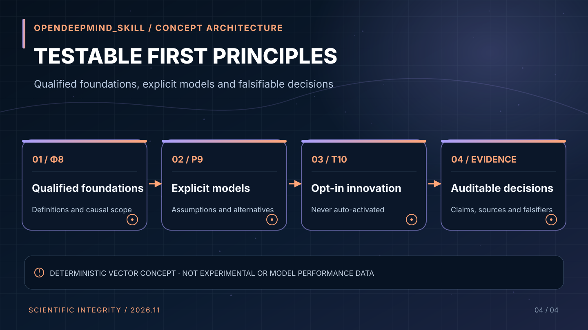
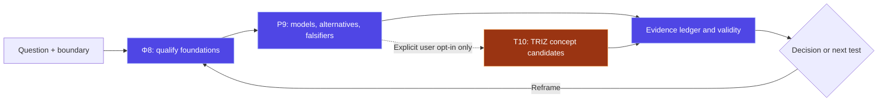
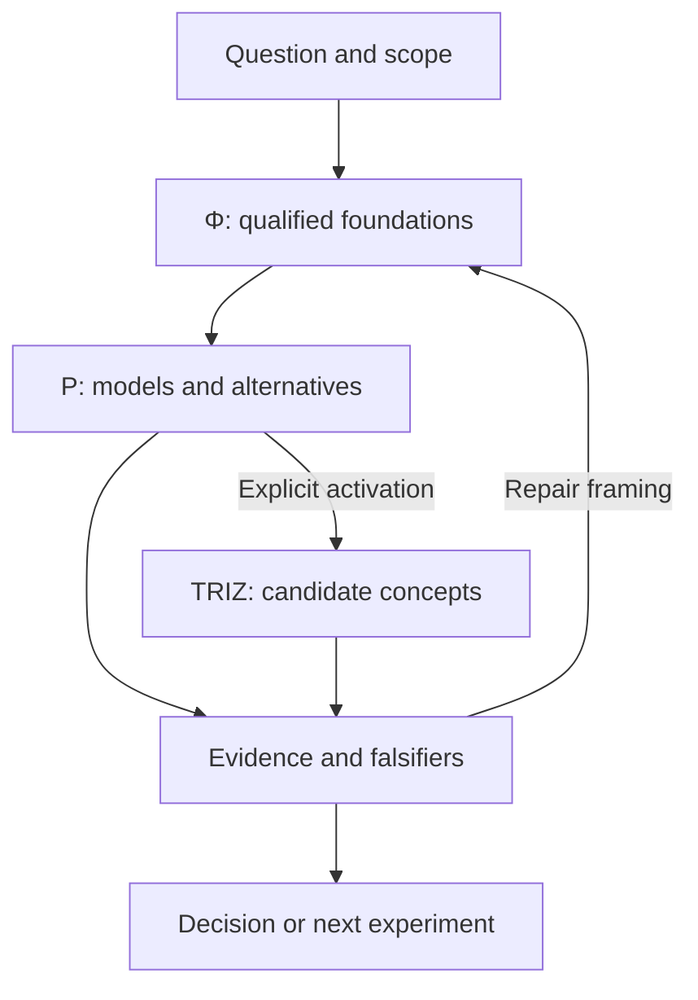

# OpenDeepMind_skill


**A traceable route from a well-posed question to an explicit model and a testable decision.**

[简体中文](README.zh-CN.md) · [Skill router](open-deep-mind/SKILL.md) · [Architecture](open-deep-mind/ARCHITECTURE.md) · [Module registry](open-deep-mind/MODULES.json) · [Benchmark](BENCHMARK.md) · [Changes](CHANGELOG.md)


*AI-generated concept artwork with exact, outlined English labels and mathematical notation. It illustrates the implemented contracts and project vision; it is not a measured result. [Artwork provenance and diagram archive](docs/assets/README.md).*

OpenDeepMind is a portable Agent Skill comprising three isolated reasoning modules. An Agent-Skills-compatible host supplies the model; this repository supplies methods, structured contracts, context preparation, evidence validation and a separate behavioral evaluation framework. The core Python tools run with the standard library. CI uses Python 3.12.

The project is independent and has no affiliation with or endorsement by Google DeepMind, OpenAI, Anthropic, MATRIZ, the Altshuller Institute or referenced repository maintainers. See [LICENSE.md](LICENSE.md), [NOTICE.md](NOTICE.md) and [VERSION](VERSION).

## 2026 architecture: four reviewable stages



Editable vector concept only. Execution, evidence, and scientific qualification must be established from source-linked records, not from this artwork.

## Reviewable reasoning route and opt-in boundary



This is a **text-editable reasoning schematic**, not an evaluation result. Φ and P remain independent canonical methods, TRIZ never auto-activates, and generated concepts return to evidence checks. Repository validators establish structural correctness; behavioral improvements need paired evaluation runs, isolated inputs, model/version records and retained raw grading artifacts.

## 1. Capabilities and concrete outputs

| Component | What it does | Source and output |
|---|---|---|
| First Philosophy, **Φ8 = Φ0…Φ7** | Qualifies definitions, evidence, causal commitments, boundary, scale and values | [Canonical method](open-deep-mind/first-philosophy/METHOD.md); Foundation Charter |
| First Principles, **P9 = P1…P9** | Decomposes requirements, builds explicit models, compares alternatives and specifies falsifiers | [Canonical method](open-deep-mind/first-principles/METHOD.md); model and decision contracts |
| TRIZ, **T10 = T1…T10** | Generates engineering concepts after explicit activation | [Canonical router](open-deep-mind/triz/ROUTER.md); candidates return to P for validation |
| Context preparation | Loads the selected route, source identities and shared quality gate within a byte budget | [prepare_context.py](open-deep-mind/scripts/prepare_context.py); `PREPARED_NOT_EXECUTED` receipt |
| Claim ledger | Checks typed records, references, inference dependencies and cycles | [validate_ledger.py](open-deep-mind/scripts/validate_ledger.py); structural diagnostics |
| Evaluation layer | Creates isolated iterations, validates run/grading records and aggregates comparable observations | [Evaluation scripts](open-deep-mind/evals/scripts/); auditable JSON reports |

The evaluation layer observes the three modules. It is not a fourth reasoning module and is never loaded by the context-preparation CLI. Numerical solvers, experimental instruments, model API calls and independent scientific certification must be supplied externally.



## 2. Start with a runnable check and a clear question

```bash
git clone https://github.com/SUNHAOJUN22/OpenDeepMind_skill.git
cd OpenDeepMind_skill
python open-deep-mind/scripts/validate_repository.py .
python open-deep-mind/scripts/validate_ledger.py open-deep-mind/assets/example-ledger.json
python open-deep-mind/scripts/prepare_context.py --route p --format manifest
```

Expose `open-deep-mind/` to your host's skill discovery mechanism and use [SKILL.md](open-deep-mind/SKILL.md) as its router. For context preparation, select a route deliberately:

```bash
python open-deep-mind/scripts/prepare_context.py --route phi --format markdown
python open-deep-mind/scripts/prepare_context.py --route phi-p --format json
python open-deep-mind/scripts/prepare_context.py --route triz --triz-requested --format manifest
```

`--route triz` requires `--triz-requested` and includes P for subsequent concept validation. The default context budget is 256 KiB, including source labels; `--max-bytes` changes that budget. Missing resources, an invalid activation or an insufficient budget fail before context is emitted. A manifest contains fresh SHA-256 identities and UTF-8 byte counts. Preparation does not execute a model, and its token, quality, cost and model-latency observations remain null.

Use this task prompt with the host agent:

```text
Decision: Select the next calculation or experiment that can distinguish
          the leading mechanism from a serious rival.
Boundary: State the system, conditions, time scale and excluded effects.
Evidence: Link observations with units, uncertainty and provenance.
Constraints: State hard limits, their authority and who can revise them.
Unknowns: Identify missing information that could change the decision.
Process: Qualify unstable framing with Φ; construct and challenge models
         with P. Keep observations, laws, assumptions and closures distinct.
Deliver: A typed ledger, explicit model, rival, falsifier, reversible next
         action and review trigger. Enable TRIZ only on my explicit request.
```

| Situation | Useful route | Acceptance question |
|---|---|---|
| Objective, definition or causal framing is unstable | Φ, then P | Is the framing qualified enough to support the model? |
| Boundary and technical objective are already clear | P | Are units, closures, constraints and falsifiers explicit? |
| Engineering concepts are explicitly requested | TRIZ, then P | Has each candidate returned to physical and evidential checks? |
| Comparing the skill's behavior | Separate evaluation framework | Are observations reproducible and paired under comparable conditions? |

## 3. Claim types, graph integrity and numeric boundaries

The [claim schema](open-deep-mind/assets/claim-ledger.schema.json) preserves eight types. The compatibility API accepts these codes or their corresponding full names.

| Code | Meaning | Required distinction |
|---|---|---|
| D | Definition | Operational meaning, not an observed fact |
| O | Observation | Recorded evidence with provenance |
| L | Law / invariant | Supported relation within a stated domain |
| C | Constraint | Boundary or requirement with authority and scope |
| A | Assumption | Revisable premise with a failure or sensitivity condition |
| E | Empirical closure / estimate | Fitted, learned or heuristic relation with provenance |
| V | Value | Stakeholder objective, preference or normative commitment |
| U | Unknown | Unresolved information that may affect the decision |

In the directed ledger graph $G=(N,E)$, $N$ contains claim and inference nodes and $E$ contains references. The edge symbol $E$ here is distinct from the empirical-closure type code.

$$
\forall(u,v)\in E:\ u,v\in N,\qquad G\text{ is acyclic}.
$$

The iterative validator limits raw JSON to 8 MiB, nesting to 128 levels, records to 10,000 and references to 100,000. It rejects duplicate JSON keys, unpaired Unicode surrogates, nonfinite values and nonzero numbers that underflow to zero during float conversion. Exact zero such as `0e-999` and a representable subnormal such as `5e-324` remain subject to ordinary field validation. Ledger validation accepts only a stable regular file: symbolic links, directories, FIFOs and other special files are rejected before parsing; on POSIX, the file is opened nonblocking and no-follow, then checked against the observed device and inode identity.

Optional confidence values follow:

$$
c_i\in\mathbb R,\quad \operatorname{finite}(c_i),\quad 0\le c_i\le1.
$$

Omit `confidence` if there is no numeric estimate. Explicit null, Boolean values and numeric strings are invalid. Structural consistency does not establish a claim's truth, and confidence is not a calibrated probability without a supporting calibration procedure.

## 4. Mathematics that the Python code actually computes

The executable sources are [contracts_v17.py](open-deep-mind/scripts/contracts_v17.py) and [aggregate_benchmark.py](open-deep-mind/evals/scripts/aggregate_benchmark.py). The following definitions describe their reported quantities.

### Slot completeness and publication boundaries

A benchmark slot identifies a case, configuration and repetition. In the compatibility helper, let $S$ be the nonempty unique expected set and $n_s$ the number of observations of slot $s$. Then:

$$
C_{\mathrm{helper}}=\frac{\sum_{s\in S}\mathbf1[n_s=1]}{|S|}.
$$

Missing, duplicate and orphan slots have distinct diagnostics. Duplicates do not receive extra weight. The helper now builds the expected-membership set once, avoiding its reconstruction for every observed identity; large-inventory regression tests preserve the same verdicts and use a deterministic hash-work budget rather than a noisy runtime threshold.

The full aggregator counts a slot only after validating both its run and grade. With $S_{\mathrm{valid}}$ denoting those complete, validated expected identities:

$$
C_{\mathrm{aggregate}}=\frac{|S_{\mathrm{valid}}|}{|S|}.
$$

Completeness of one does not override malformed metadata, duplicates, orphans or other recorded blockers. Complete internal artifacts return `ARTIFACT_SET_COMPLETE`; `publication_ready` remains false. Publication needs independent verification of actual execution, raw evidence, holdout sealing, grader identity and authority.

### Assertions, effective verdicts and optional metrics

For $n$ assertions with Boolean outcomes $a_j$:

$$
p=\sum_{j=1}^{n}\mathbf1[a_j=\mathrm{true}],\qquad f=n-p,\qquad
r_a=\begin{cases}p/n,&n>0,\\0,&n=0.\end{cases}
$$

Reported counts and rates must agree with the records; the absolute rate-consistency tolerance is $10^{-12}$. Assertion text is unique after trimming, and passing assertions need nonempty response evidence. A case passes only when every assertion passes and there is no red blocker, reported module leakage or forbidden TRIZ activation. The same effective verdict is used in aggregate rates and paired wins:

$$
\widehat P=\frac1N\sum_{i=1}^{N}\mathbf1[\operatorname{effective\_pass}_i].
$$

Routing and false-TRIZ activation also use recorded route/module metadata. Forced-route ablation omits production-routing accuracy. Semantic judgments still require substantive grading.

For pairing, distinguish the common candidate identities $I_0$ from the accepted comparable identities $I$. Model/version mismatches or missing/different `execution_conditions` exclude a candidate. Equal omitted versions are counted in `unversioned_paired_runs`; they are not independent version attestation.

$$
I\subseteq I_0,\qquad I_z=\{i\in I:\ z_{L,i},z_{R,i}\text{ are both recorded}\},\qquad
\overline{\Delta z}=\frac1{|I_z|}\sum_{i\in I_z}(z_{L,i}-z_{R,i}).
$$

`candidate_paired_runs` counts $|I_0|$ and `paired_runs` counts $|I|$. Optional metrics can have fewer pairs; an empty $I_z$ produces null, never an imputed zero. Individual valid observations remain available even when their pair is excluded. Blind pairwise judgment is a separate evidence artifact.

For sorted recorded values $z_{(1)}\le\cdots\le z_{(n)}$, the distribution helper reports nearest-rank quantiles:

$$
Q_p=z_{(\lceil pn\rceil)},\qquad p\in\{0.50,0.95\},\ n>0.
$$

An empty sample returns count zero and null quantiles. Token counts and durations use non-Boolean integers bounded by $2^{53}-1$. Costs use integer millionths of a currency unit and retain currency, billing basis and pricing-snapshot identity; matched cost deltas require those identities to agree. See the [cost record contract](open-deep-mind/evals/README.md#cost-and-latency-records).

The [semantic rubric](open-deep-mind/evals/rubric.md) has ten anchored dimensions $s_k\in[0,5]$ and weights totaling 100. Its scoring contract is:

$$
Q=\sum_{k=1}^{10}w_k\frac{s_k}{5},\qquad \sum_{k=1}^{10}w_k=100.
$$

The compatibility helper `weighted_behavior_score` instead computes an equal-weight mean of complete normalized slot scores:

$$
B=\frac1N\sum_{i=1}^{N}b_i,\qquad 0\le b_i\le1.
$$

Missing coverage yields no score; duplicate expected IDs and invalid/nonfinite/Boolean scores are rejected. Do not feed 0–100 rubric points into this normalized helper.

## 5. Mathematical reasoning contracts for scientific work

The equations below describe templates in the [P9 method](open-deep-mind/first-principles/METHOD.md) and [model schema](open-deep-mind/first-principles/model-contract.schema.json). They guide an external solver or analysis; this skill does not solve the equations itself. Record variables, units, parameters and sources, constraints, closures, initial/boundary conditions, observation errors, validity limits and falsifiers.

### Feasible decisions and explicit objectives

$$
\mathcal X_f=\{x:h(x)=0,\ g(x)\le0\},\qquad
x^\star\in\operatorname*{arg\,min}_{x\in\mathcal X_f}J(x;V).
$$

Here $x$ is the decision vector, $h,g$ are equality/inequality constraints, $J$ is the objective and $V$ records value commitments. Exclude hard-constraint violations before preference scoring, and retain a serious rival and a do-nothing option when relevant.

### Dynamics, conservation and observation

$$
\dot{\mathbf x}=\mathbf f(\mathbf x,\mathbf u,\boldsymbol\theta,t),\qquad
\frac{\partial q}{\partial t}+\nabla\cdot\mathbf J_q=s_q.
$$

States $\mathbf x$, controls $\mathbf u$, parameters $\boldsymbol\theta$, conserved density $q$, flux $\mathbf J_q$ and source $s_q$ require compatible units and stated domains. Measurement enters through an observation operator:

$$
\mathbf y=\mathcal H(\mathbf x,\boldsymbol\theta)+\boldsymbol\epsilon.
$$

Identify whether $\boldsymbol\epsilon$ contains instrument noise, model discrepancy or both. Check limiting cases, conservation, numerical convergence, sensitivity and identifiability. Agreement with calibration data does not supply independent validation.

### Evidence updates, scale bridges and intervention

$$
p(\theta\mid y)\propto p(y\mid\theta)p(\theta),\qquad
z=\mathcal C(x),\qquad y_{\mathrm{macro}}=\mathcal M(z;\eta).
$$

A Bayesian update needs a justified prior and likelihood. A scale bridge needs a mapping $\mathcal C$, closure parameters $\eta$, uncertainty, lost information and a validation domain. A molecular result alone does not establish process-scale performance.

$$
X_i=f_i(\operatorname{Pa}_i,U_i),\qquad
P(Y\mid X=x)\ne P(Y\mid\operatorname{do}(X=x))\text{ in general}.
$$

A structural causal hypothesis requires an identification argument or discriminating intervention before association is promoted to causation.

### Choosing the next discriminating study

For design $d$, future observation $Y$, uncertain state $\theta$, feasible actions $\mathcal A$ and utility $U$, P9 defines expected sample information value as:

$$
\operatorname{EVSI}(d)=
\mathbb E_{Y\mid d}\!\left[\max_{a\in\mathcal A}\mathbb E_{\theta\mid Y,d}U(a,\theta)\right]
-\max_{a\in\mathcal A}\mathbb E_\theta U(a,\theta).
$$

The action is selected using posterior expected utility before averaging over possible observations. Under the same feasible actions, unchanged utility and the option to ignore data:

$$
0\le\operatorname{EVSI}(d)\le\operatorname{EVPI},\qquad
\operatorname{EVPI}=\mathbb E_\theta\max_{a\in\mathcal A}U(a,\theta)
-\max_{a\in\mathcal A}\mathbb E_\theta U(a,\theta).
$$

An independent fair bit has zero information value in the binary decision example in P9; a 75%-accurate observation has EVSI 0.25, while a perfect observation has 0.5. Those are finite illustrative utility calculations, not measured model scores. Subtract acquisition, delay and implementation costs in compatible utility units. If the prior, likelihood or utility is unsupported, keep the decision uncertainty explicit.

## 6. Run a reproducible evaluation

The authored case set has 60 cases, a fixed 36/12/12 train/validation/holdout split and three repetitions. Four configurations compare no skill, a commit-pinned external first-principles baseline, the full skill and a no-TRIZ ablation. The validation design contains 114 slots: 12 cases × 3 configurations × 3 repetitions, plus 2 explicit-TRIZ cases × 3 ablation repetitions. This is a design count, not completed model work.

```bash
python open-deep-mind/evals/scripts/validate_evals.py
python open-deep-mind/evals/scripts/create_workspace.py --iteration 1 --split validation --workspace ../OpenDeepMind_skill-workspace
```

Creation publishes a complete iteration atomically and refuses an existing destination. Populate the expected `run_record.json`, raw response and `grading.json` artifacts with an authorized external runner. Preserve model/version, sampling/reasoning settings, tool access, input identities, repository revision, repetitions and grading evidence. Do not convert holdout cases into runtime instructions.

After real records have been supplied:

```bash
python open-deep-mind/evals/scripts/aggregate_benchmark.py ../OpenDeepMind_skill-workspace/iteration-1
```

The default report is `benchmark.json`. An empty or incomplete iteration cannot certify a complete result. A custom `--output` cannot replace `manifest.json` or anything in an `eval-*` evidence directory, including parent-directory aliases. This pre-publication path check does not protect against concurrent filesystem changes. See [evaluation documentation](open-deep-mind/evals/README.md) and [repair/migration notes](docs/acceptance-repair.md).

## 7. Acceptance, troubleshooting and operating strategy

Run every maintained software gate from the repository root:

```bash
python open-deep-mind/scripts/validate_repository.py .
python open-deep-mind/scripts/validate_ledger.py open-deep-mind/assets/example-ledger.json
python open-deep-mind/first-philosophy/scripts/validate_module.py
python open-deep-mind/first-principles/scripts/validate_module.py
python open-deep-mind/triz/scripts/validate_triz_module.py
python open-deep-mind/evals/scripts/validate_evals.py
python open-deep-mind/triz/scripts/lookup_matrix.py --improve 1 --worsen 3 --json
python open-deep-mind/triz/scripts/lookup_standard_solution.py 1.2.1 --json
python -m unittest discover -s open-deep-mind/tests -p 'test_*.py'
python -m compileall -q open-deep-mind
git diff --check
```

[CI](https://github.com/SUNHAOJUN22/OpenDeepMind_skill/actions/workflows/validate.yml) also rejects generated/source drift. The [seven-repository acceptance workflow](https://github.com/SUNHAOJUN22/TsaoSciResearcher/actions/workflows/six-repository-acceptance.yml) coordinates extended software regression. Only completed receipts for the bound source commits establish six hours; this README does not predeclare that outcome or a behavioral score.

| Symptom | Action |
|---|---|
| TRIZ activation rejected | Obtain an explicit request/acceptance and pass the declaration; do not infer activation from keywords. |
| Context exceeds budget | Choose a sufficient route and progressively load relevant resources; preserve quality gates. |
| Ledger or JSON rejected | Repair the exact type, numeric range, source reference or cycle named in the diagnostic. |
| Paired count is smaller than the candidate count | Inspect `excluded_pairs`, model/version and recorded execution conditions. |
| Metric is null | Supply the missing observation; do not treat missing data as zero. |
| Artifacts are complete but publication is not authorized | Obtain independent execution, grading, holdout and release evidence. |

Start with one traceable model and one serious rival. Use the lightest sufficient route, bind every material result to units and evidence, preserve red blockers, and choose the smallest reversible action that can change the decision. The [quality gates](open-deep-mind/references/quality-gates.md), [ledger template](open-deep-mind/assets/claim-ledger-template.md) and [decision schema](open-deep-mind/first-principles/decision-record.schema.json) make that discipline reviewable.
