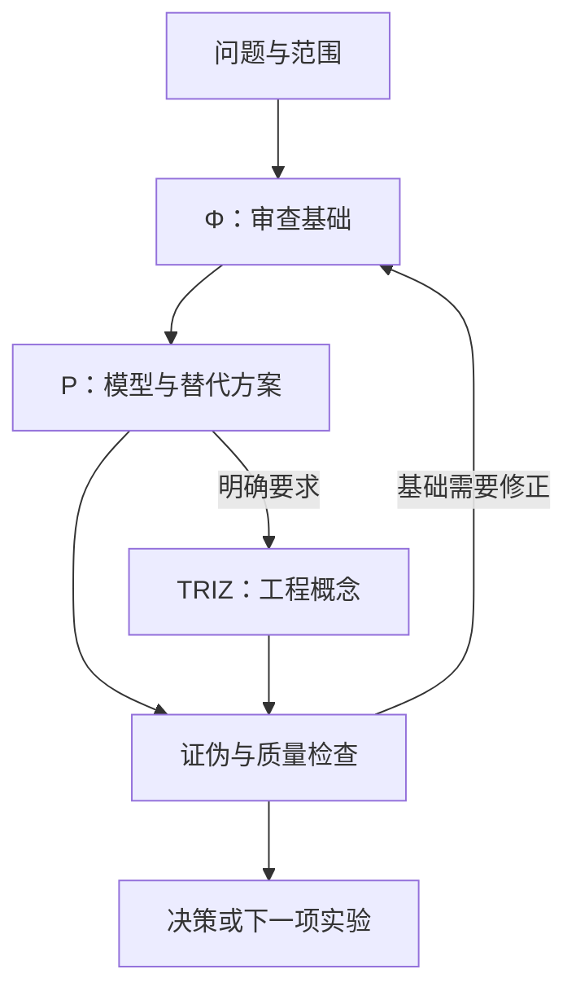

# OpenDeepMind_skill


**先审查基础，再构建模型，让结论接受检验。**

[English](README.md) · [运行时路由](open-deep-mind/SKILL.md) · [模块架构](open-deep-mind/ARCHITECTURE.md) · [模块注册表](open-deep-mind/MODULES.json) · [行为评测](BENCHMARK.md)


*本图展示功能愿景，物理场景与数学符号均为概念表达，不代表实测数据、已执行模拟或已发布的性能结果。*

OpenDeepMind 是一套可移植的 Agent Skill，由三个相互隔离的推理模块和一个独立评测层构成。仓库中的 Python 工具负责核验命题台账、模块合同和评测工件；语言模型服务、科学求解器与实验仪器由外部环境提供。

本项目独立开发，与 Google DeepMind、OpenAI、Anthropic、MATRIZ、Altshuller Institute 及引用仓库的维护者均无隶属或背书关系。版本与许可见 [VERSION](VERSION)、[LICENSE.md](LICENSE.md) 和 [NOTICE.md](NOTICE.md)。

## 一、代码与方法分别承担什么工作

| 组件 | 输入与职责 | 输出及入口 |
|---|---|---|
| 第一哲学 Φ8 | 核对定义、证据、因果、边界、尺度与价值 | [Φ0–Φ7 与基础章程](open-deep-mind/first-philosophy/METHOD.md) |
| 第一性原理 P9 | 分解需求，区分定律、约束与假设，重构并检验模型 | [P1–P9、模型合同与决策记录](open-deep-mind/first-principles/METHOD.md) |
| TRIZ T10 | 用户明确要求或接受后，生成工程发明候选 | [T1–T10 路由](open-deep-mind/triz/ROUTER.md)；候选必须返回 P 验证 |
| 命题台账 | 检查字段、类型、引用、推理关系和循环依赖 | [validate_ledger.py](open-deep-mind/scripts/validate_ledger.py) |
| 评测框架 | 创建独立迭代目录，核对运行身份及评分一致性，汇总可比较记录 | [评测脚本](open-deep-mind/evals/scripts/) |
| 软件验证 | 核对模块清单、链接、Schema、夹具及回归行为 | [CI 工作流](.github/workflows/validate.yml) |

核心验证器只依赖 Python 标准库。宿主智能体由兼容 Agent Skills 的运行环境提供。`evals/` 是观察与评测层，不注册为第四个推理模块，也不用于向运行时泄露测试答案。



## 二、从一个具体问题开始

克隆仓库，将 `open-deep-mind/` 目录放入宿主运行环境规定的技能发现位置，以 [SKILL.md](open-deep-mind/SKILL.md) 为入口。不同宿主的安装位置不同；不要把完整评测题库粘入运行时指令。

```bash
git clone https://github.com/SUNHAOJUN22/OpenDeepMind_skill.git
cd OpenDeepMind_skill
python open-deep-mind/scripts/validate_repository.py .
python open-deep-mind/scripts/validate_ledger.py open-deep-mind/assets/example-ledger.json
```

CI 使用 Python 3.12。建议用可检验的目标描述任务，而不是预先指定一项技术：

```text
问题：哪一种候选机制最能解释已观察到的变化？
决策：选择下一项能够区分竞争模型的计算或实验。
边界：说明研究对象、时间尺度和适用条件。
证据：提供原始观测、单位、不确定度和来源。
约束：列出限制及有权修改限制的人。
未知：列出可能改变判断的信息缺口。
要求：先用 Φ 检查问题框架，再用 P 比较竞争模型；
      分开记录观测、假设和经验闭合，给出证伪条件与可逆的下一步。
```

对于定义和目标已清楚的技术问题，可直接进入 P。若目标含义、证据标准、因果解释或价值目标仍不明确，应先进入 Φ。检测到权衡或矛盾不会自动启用 TRIZ；如需采用，可明确要求“用 TRIZ 提出候选机制，再逐一回到物理条件和证据检查”。

## 三、命题类型与可追溯关系

规范命题类型为 `D/O/L/C/A/E/V/U`，以[命题台账 Schema](open-deep-mind/assets/claim-ledger.schema.json)为准。兼容 API 接受代码或对应完整名称；其中 **C 表示约束，E 表示经验闭合**。

| 代码 | 类型 | 使用要求 |
|---|---|---|
| D | 定义 | 含义和操作性定义明确 |
| O | 观测 | 保留测量或记录来源与条件 |
| L | 定律／不变量 | 在声明适用域内具有独立支持 |
| C | 约束 | 写明边界、要求、适用范围与修改权限 |
| A | 假设 | 可以修正，并有敏感性检查或证伪条件 |
| E | 经验闭合／估计 | 保留拟合、启发式或学习模型的数据来源 |
| V | 价值 | 明确利益相关方的目标、偏好或规范承诺 |
| U | 未知 | 说明它是否会影响下一项决策 |

把台账写成有向图 $G=(N,E)$，节点表示前提、推理或结论，边表示依赖。引用必须指向存在的节点，循环支持不能证明结论：

$$
\forall(u,v)\in E,\quad u,v\in N,\qquad G\text{ 应为无环图}.
$$

验证器使用迭代式图遍历，原始输入预算为 8 MiB、10,000 条记录、100,000 个引用，JSON 嵌套最多 128 层。重复 JSON 键、非有限数及未配对 Unicode 代理字符会被拒绝。台账和评测 JSON 读取器也拒绝在浮点转换时下溢成零的非零数：例如，负置信度或负评分 `-1e-999` 不能变成合法的零值。`0e-999` 这类有效数字为零的数，以及 `5e-324` 这类可表示的次正规数，仍可作为数值输入，并继续接受各字段的取值范围检查。这些检查保证结构和资源边界，不能证明台账中的科学陈述真实。

若填写置信度，它必须是非布尔、有限的数：

$$
0\le c_i\le1.
$$

对于命题和推理记录，没有可用的数值估计时可以省略 `confidence`。显式 JSON `null`、布尔值和数字字符串均不合法；省略字段不表示置信度为零。

除非有校准过程和相应数据，否则不能把置信度标签解释成已经校准的概率。

## 四、数理模型合同

P 的[模型合同](open-deep-mind/first-principles/model-contract.schema.json)要求记录用途、状态与参数、来源、控制关系、初始及边界条件、闭合假设、观测与误差模型、适用域和证伪条件。下面给出方法支持的**建模表达模板**；仓库本身并不数值求解这些方程。

### 1. 可行域与目标函数

$$
\mathcal X_f=\{x\mid h(x)=0,\;g(x)\le0\},\qquad
x^\star\in\operatorname*{arg\,min}_{x\in\mathcal X_f}J(x;V).
$$

$x$ 为决策变量，$h$ 为等式约束，$g$ 为不等式约束，$J$ 为目标函数，$V$ 为显式价值承诺。只有可行域与目标都得到说明，“最优”才有意义。应先排除违反硬约束的候选，再比较偏好分数。

### 2. 动力学、守恒与观测

$$
\dot{\mathbf x}=\mathbf f(\mathbf x,\mathbf u,\boldsymbol\theta,t),\qquad
\frac{\partial q}{\partial t}+\nabla\cdot\mathbf J_q=s_q.
$$

状态 $\mathbf x$、控制 $\mathbf u$、参数 $\boldsymbol\theta$、守恒密度 $q$、通量 $\mathbf J_q$ 与源项 $s_q$ 都需要单位和适用域。再通过观测算子连接模型与测量：

$$
\mathbf y=\mathcal H(\mathbf x,\boldsymbol\theta)+\boldsymbol\epsilon.
$$

应区分 $\boldsymbol\epsilon$ 中的测量噪声与模型偏差。复现校准数据不等于独立验证。可按具体任务定义无量纲残差：

$$
r=\frac{|a-b|}{\max(|a|,|b|,s_0)},\qquad s_0>0.
$$

其中 $a,b,s_0$ 具有相同单位，参考尺度 $s_0$ 与容差需要独立说明。这里是模型审查模板，不是仓库内隐藏的科学计算函数。

### 3. 证据更新与跨尺度关系

$$
p(\theta\mid y)\propto p(y\mid\theta)p(\theta),\qquad
z=\mathcal C(x),\qquad y_{\mathrm{macro}}=\mathcal M(z;\eta).
$$

贝叶斯更新需要明确先验与似然。跨尺度推论需要映射 $\mathcal C$、闭合参数 $\eta$、信息损失、不确定度与验证域。分子尺度计算本身不能直接证明工艺尺度性能。

针对干预问题，还要区分结构关系与观测关联：

$$
X_i=f_i(\operatorname{Pa}_i,U_i),\qquad
P(Y\mid X=x)\ne P(Y\mid\operatorname{do}(X=x))\text{ 通常成立}.
$$

只有补足因果识别论证或有区分力的干预证据，才能把相关性提升为因果结论。

## 五、代码实际执行的评测计算

当前评测设计包含 60 个案例，固定划分为 36 个训练、12 个验证、12 个留出案例。四个配置为 `no_skill`、`first_principles_baseline`、`opendeepmind_full` 和 `opendeepmind_no_triz_ablation`。外部基线的提交固定在[配置文件](open-deep-mind/evals/benchmark-config.json)中。留出案例不能变成针对题目的运行时规则。

默认每项重复三次。验证集有 114 个预期槽位：12 个案例 × 3 个完整配置 × 3 次重复，加上 2 个明确启用 TRIZ 的案例 × 3 次消融重复。这是试验设计数量，不是已经完成的模型执行数量。

### 1. 身份与完整性

一个槽位由有序三元组 $(\mathrm{case},\mathrm{configuration},\mathrm{repetition})$ 唯一标识。令 $S$ 为预期集合，$R,G$ 为有效运行与评分身份集合：

$$
C=\frac{|S\cap R\cap G|}{|S|},\qquad |S|>0.
$$

重复槽位不能重加权。缺失槽位、错误元数据、清单之外的运行或评分工件都会阻止完整性通过。重复编号、token 数和耗时为非布尔整数，上限为 $2^{53}-1$，重复编号从一开始。运行与评分 JSON 文件同样受 8 MiB 和 128 层预算限制。

### 2. 断言与案例判定

对于 $n$ 项布尔断言 $a_j$：

$$
p=\sum_{j=1}^{n}\mathbf1[a_j=\mathrm{true}],\qquad f=n-p,\qquad
r_a=\begin{cases}p/n,&n>0\\0,&n=0.\end{cases}
$$

评分摘要中的 `passed`、`failed`、`total` 与 `pass_rate` 必须与逐项记录一致，通过率采用 $10^{-12}$ 的绝对一致性容差。断言文本去除首尾空白后不得重复，通过项必须附有非空的响应证据。空断言列表不能形成通过的案例。

案例通过还要求没有红色阻断项、已报告的模块泄漏和禁止的 TRIZ 启用。TRIZ 启用与路由正确性根据运行记录中的路由和模块元数据计算，不能只相信评分者填写的布尔声明。总通过率和成对胜负共用同一有效判定：

$$
\widehat P=\frac1N\sum_{i=1}^{N}\mathbf1[\mathrm{effective\_pass}_i].
$$

强制路由的消融配置不计算生产路由准确率。语义层面的模块泄漏仍需要实质评分；JSON 结构一致不证明外部模型输出的含义或来源已经得到独立核验。

### 3. 成对比较与语义评分

只有共有的案例及重复身份进入成对比较。设 $I$ 为共有集合，$I_z\subseteq I$ 为双方都有有效指标 $z$ 的身份子集。对于 $|I_z|>0$：

$$
\overline{\Delta z}=\frac1{|I_z|}\sum_{i\in I_z}(z_{L,i}-z_{R,i}).
$$

汇总输出包括断言通过率、评分、token 数和耗时差，以及有效案例胜负与平局。`paired_runs` 计数为 $|I|$；`judge_score` 等可选指标可能只使用其中部分配对。若 $I_z$ 为空，该指标的平均差为 JSON `null`。缺失指标不会静默填零。盲评仍应保留独立评分工件。

[语义评分表](open-deep-mind/evals/rubric.md)有十个维度，权重 $w_k$ 合计 100，锚定分数 $s_k\in[0,5]$：

$$
Q=\sum_{k=1}^{10}w_k\frac{s_k}{5},\qquad\sum_k w_k=100.
$$

兼容函数 `contracts_v17.weighted_behavior_score` 则接收 $b_i\in[0,1]$ 的槽位分数，并计算等权均值：

$$
B=\frac1N\sum_i b_i.
$$

不要把 0–100 分的语义评分直接传入这个归一化接口。覆盖不完整时接口不返回分数；重复预期 ID 会被拒绝。

## 六、实际使用评测框架

创建一个新的迭代目录，已有迭代不会被覆盖：

```bash
python open-deep-mind/evals/scripts/validate_evals.py
python open-deep-mind/evals/scripts/create_workspace.py --iteration 1 --split validation
```

使用外部已授权模型运行器填入每个预期槽位的 `run_record.json` 和 `grading.json`。成对试验应保持模型、版本、设置、工具权限、输入、仓库版本和重复设计可比较，然后执行：

```bash
python open-deep-mind/evals/scripts/aggregate_benchmark.py ../OpenDeepMind_skill-workspace/iteration-1
```

报告默认写入 `benchmark.json`。自定义 `--output` 不能指向 `manifest.json` 或任何 `eval-*` 案例目录（包括原始响应）；通过父目录别名指入这些证据路径同样会被拒绝。其他位置的默认或自定义报告仍可重复更新。该检查在发布前核对路径，不保证抵御并发文件系统变更。

`artifact_set_complete=true` 仅表示工件内部完整一致。聚合器始终保持 `publication_ready=false`；模型执行、原始工件、留出集封存、评分者身份与发布权限必须由独立发布流程核验。v16/v17 兼容 API 对完整记录返回 `ARTIFACT_SET_COMPLETE`，替代含义模糊的 `READY`；类似布尔值的字符串会被拒绝。迁移说明见[修复记录](docs/acceptance-repair.md)。

## 七、软件检查与交付证据

完整执行现有门禁：

```bash
python open-deep-mind/scripts/validate_repository.py .
python open-deep-mind/scripts/validate_ledger.py open-deep-mind/assets/example-ledger.json
python open-deep-mind/first-philosophy/scripts/validate_module.py
python open-deep-mind/first-principles/scripts/validate_module.py
python open-deep-mind/triz/scripts/validate_triz_module.py
python open-deep-mind/evals/scripts/validate_evals.py
python open-deep-mind/triz/scripts/lookup_matrix.py --improve 1 --worsen 3 --json
python open-deep-mind/triz/scripts/lookup_standard_solution.py 1.2.1 --json
python -m unittest discover -s open-deep-mind/tests -p 'test_*.py'
python -m compileall -q open-deep-mind
git diff --check
```

回归覆盖真实聚合 CLI 的错误输入、JSON 边界、身份与重复处理、图预算以及兼容合同。合成夹具用于检查软件行为，不代表语言模型能力。已知的历史矩阵转录异常保留其说明，不通过静默改动制造“零警告”。

当前结果应以[对应提交的 CI](https://github.com/SUNHAOJUN22/OpenDeepMind_skill/actions/workflows/validate.yml)为准。延长软件回归由[七仓联合验收工作流](https://github.com/SUNHAOJUN22/TsaoSciResearcher/actions/workflows/six-repository-acceptance.yml)协调；六小时结果需要已完成且通过验证的规定回执，本 README 不预写通过结论。

## 八、使用策略

1. **先写清下一项决策。**说明哪些证据会改变判断，以及最低有用置信度。
2. **从一个可追溯模型和一个有力竞争模型开始。**增加公式必须能改变检验或决策。
3. **区分构建与资格。**计划、模板、拟合曲线和已执行运行承担不同证据角色。
4. **采用足够而不过度的方法。**明确技术问题进入 P；框架不稳先用 Φ；工程发明可明确启用 TRIZ。
5. **保留上下文。**每个结果附单位、源数据、版本、适用条件、误差和未解决假设。
6. **证据不足时给出下一步。**说明未知是什么、会影响什么，以及哪项行动能区分候选解释。

进一步阅读：[架构](open-deep-mind/ARCHITECTURE.md)、[质量门](open-deep-mind/references/quality-gates.md)、[命题台账模板](open-deep-mind/assets/claim-ledger-template.md)、[模型合同](open-deep-mind/first-principles/model-contract.schema.json)、[决策记录](open-deep-mind/first-principles/decision-record.schema.json)及[变更记录](CHANGELOG.md)。
