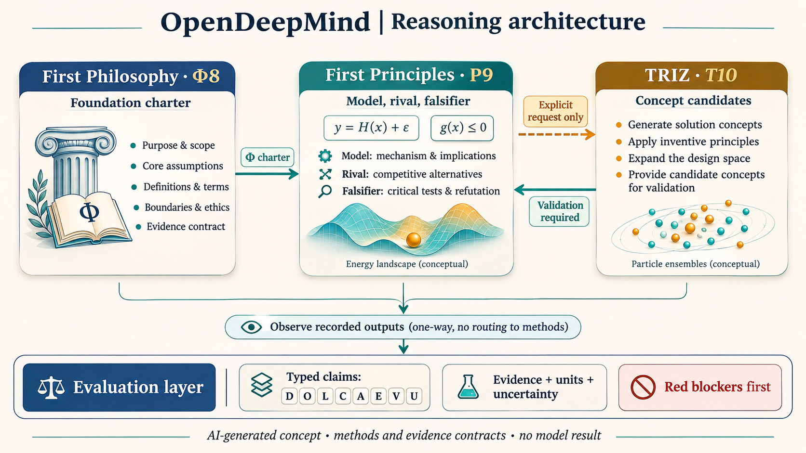
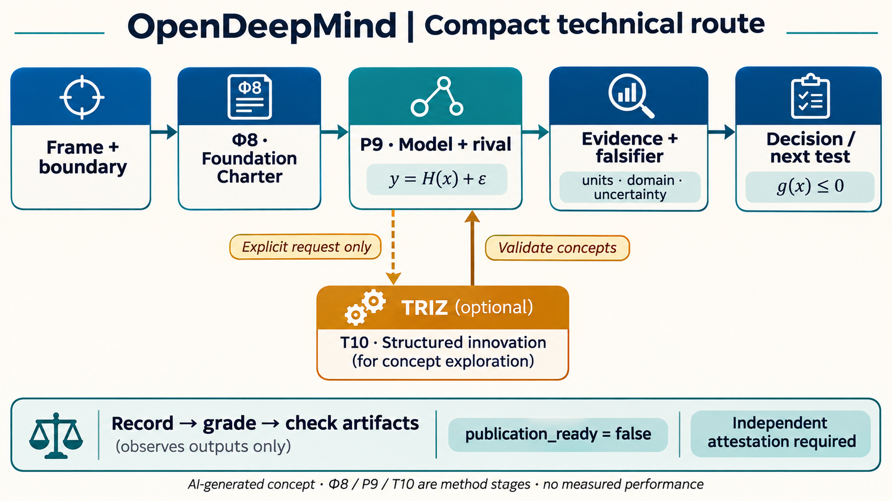
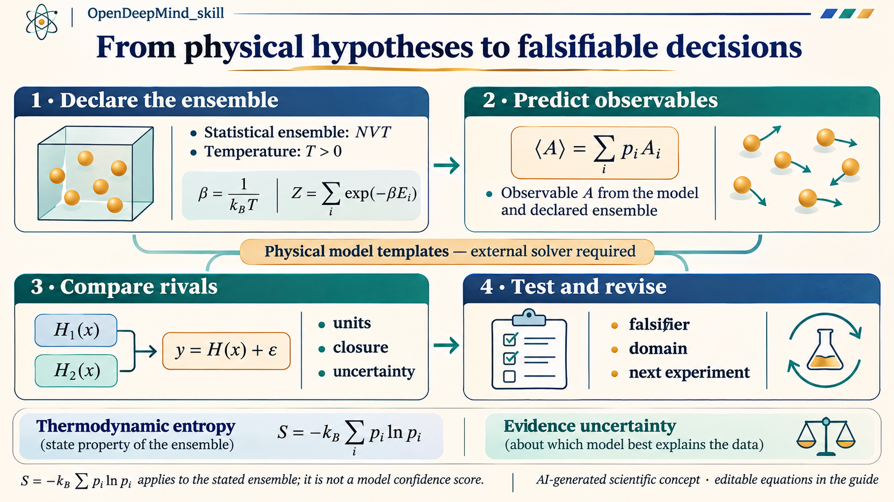
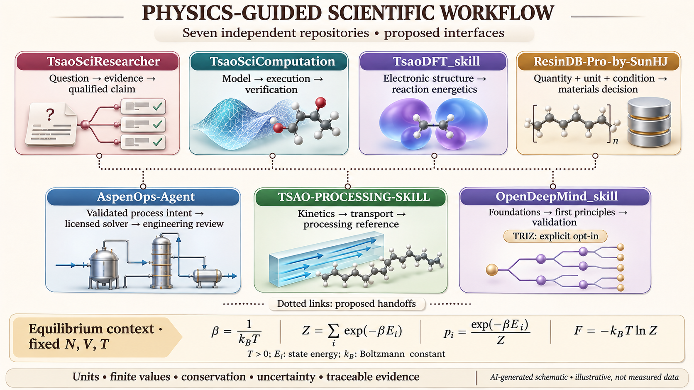

# OpenDeepMind_skill


**先确认问题成立，再构建显式模型，最后选择可检验的下一步。**

[English](README.md) · [科学指南](docs/scientific-guide.zh-CN.md) · [技能路由](open-deep-mind/SKILL.md) · [架构合同](open-deep-mind/ARCHITECTURE.md) · [评测入口](BENCHMARK.md) · [模块注册表](open-deep-mind/MODULES.json) · [版本](VERSION)



OpenDeepMind 是一个包含三个独立方法模块的可移植 Agent Skill。兼容宿主提供模型；仓库提供规范方法、带类型的证据合同、绑定源文件身份的上下文准备器，以及仅依赖 Python 标准库的验证工具。评测层观察记录中的行为，不参与运行时路由。

## 一、选择路线与交付物

| 路线或工具 | 用途 | 可检查产物 |
|---|---|---|
| **Φ8**，Φ0–Φ7 | 审查定义、证据、边界、尺度与价值 | [Foundation Charter](open-deep-mind/first-philosophy/METHOD.md) |
| **P9**，P1–P9 | 分解、建模、竞争模型、证伪与决策 | [模型与决策合同](open-deep-mind/first-principles/METHOD.md) |
| **T10**，T1–T10 | 显式请求后生成工程发明概念 | [TRIZ 候选](open-deep-mind/triz/ROUTER.md)，返回 P 验证 |
| 上下文准备 | 只读取选定规范路线与共享门禁 | `PREPARED_NOT_EXECUTED`、源文件哈希、字节数 |
| 论断账本 | 检查类型、引用、循环与数值边界 | 结构诊断；confidence 需要校准依据 |
| 行为评测 | 验证运行、评分与可比配对 | 描述性聚合 JSON；仍需独立认证 |

TRIZ **仅显式启用**。任务困难或出现矛盾不会自动触发它；Φ 不调用 TRIZ，TRIZ 概念必须返回 P 做物理与证据验证。评测层不是第四个推理模块。

## 二、先运行检查

核心工具只需 Python 标准库，维护中的 CI 使用 Python 3.12。在源码检出目录执行：

```bash
git clone https://github.com/SUNHAOJUN22/OpenDeepMind_skill.git
cd OpenDeepMind_skill
python open-deep-mind/scripts/validate_repository.py .
python open-deep-mind/scripts/validate_ledger.py open-deep-mind/assets/example-ledger.json
python open-deep-mind/scripts/prepare_context.py --route phi-p --format manifest
```

通过宿主的技能发现机制暴露 `open-deep-mind/`。默认上下文预算为含标签的 256 KiB。`--route triz --triz-requested` 声明显式请求并加载用于验证的 P；它不是独立授权证明。准备上下文不等于执行模型，也不测量质量、token、费用或模型延迟。

任务输入应包含决策目标、系统边界、条件、证据、硬约束、未知项和复审触发条件，并要求强竞争模型及有区分力的证伪条件。八类论断必须分开：**D** 定义、**O** 观测、**L** 定律、**C** 约束、**A** 假设、**E** 经验闭合、**V** 价值、**U** 未知。

## 三、简洁技术路线



每个结论绑定其前提与证据。定量问题先写观测模型与可行域：

$$
y=\mathcal H(x,\theta)+\epsilon,\qquad \mathcal X_f=\{x:h(x)=0,\ g(x)\le0\}.
$$

$x$ 是状态或决策，$\theta$ 是参数，$\mathcal H$ 是观测算子，$\epsilon$ 是明确说明的噪声／模型差异项。单位、参数来源、初始／边界条件、闭合、适用域和证伪条件共同组成合同。诊断评分再高也不能覆盖红色阻断项。

## 四、统计力学与物理思想



对于声明清楚的平衡 NVT 系综，$T>0$、微观态能量为 $E_i$：

$$
\beta=(k_BT)^{-1},\quad Z=\sum_i e^{-\beta E_i},\quad p_i=\frac{e^{-\beta E_i}}Z,\quad \langle A\rangle=\sum_i p_i A_i.
$$

$$
F=-k_BT\ln Z,\qquad S=-k_B\sum_i p_i\ln p_i.
$$

这些是**物理建模模板**，其中 $\beta E_i$ 必须无量纲；本技能没有实现系综求解器。热力学熵与论断不确定性分别解释。跨尺度结论必须有桥接模型、信息损失说明和验证域。[科学指南](docs/scientific-guide.zh-CN.md) 展开来源、简并度、极限、守恒、贝叶斯更新、EVSI 和实现映射。原理来源：[Tong 统计物理讲义](https://www.damtp.cam.ac.uk/user/tong/statphys/statmechhtml/S1.html)。

## 五、先验证证据，再报告效果

[评测定义](open-deep-mind/evals/benchmark-config.json) 包含 60 个案例，固定为 36／12／12 训练、验证、留出集，四种配置、三次重复；验证设计有 114 个预期槽位。这是实验设计数量，不是已完成模型运行数。

```bash
python open-deep-mind/evals/scripts/validate_evals.py
python open-deep-mind/evals/scripts/create_workspace.py --iteration 1 --split validation --workspace ../OpenDeepMind_skill-workspace
```

有授权的外部执行器必须提供真实回答、运行记录和评分证据。配对要求模型／版本相容，并严格匹配声明的采样、推理设置、工具权限、输入路径／哈希数组及顺序。同一字面路径声明冲突 SHA-256 会使运行无效；不同路径允许哈希相同。

填入真实记录后运行：

```bash
python open-deep-mind/evals/scripts/aggregate_benchmark.py ../OpenDeepMind_skill-workspace/iteration-1
```

对可比配对 $I$，只在实际记录指标 $z$ 的配对集合 $I_z$ 上统计：

$$
\overline{\Delta z}=|I_z|^{-1}\sum_{i\in I_z}(z_{L,i}-z_{R,i}),\qquad I_z\subseteq I.
$$

空样本返回 null，缺失观测不能当作零。配对被排除时，单侧有效观测仍然保留。完整 CLI 在产物完整时使用 `publication_status=EVIDENCE_COMPLETE_AWAITING_INDEPENDENT_ATTESTATION`，兼容辅助函数使用 `status=ARTIFACT_SET_COMPLETE`。**两者均保持 `publication_ready=false`。** 元数据一致性不能认证真实执行、输入字节、独立评分或发布资格。参见[评测合同](open-deep-mind/evals/README.md)。

## 六、执行原有软件验收

```bash
python open-deep-mind/scripts/validate_repository.py .
python open-deep-mind/scripts/validate_ledger.py open-deep-mind/assets/example-ledger.json
python open-deep-mind/first-philosophy/scripts/validate_module.py
python open-deep-mind/first-principles/scripts/validate_module.py
python open-deep-mind/triz/scripts/validate_triz_module.py
python open-deep-mind/evals/scripts/validate_evals.py
python open-deep-mind/triz/scripts/lookup_matrix.py --improve 1 --worsen 3 --json
python open-deep-mind/triz/scripts/lookup_standard_solution.py 1.2.1 --json
python -m unittest discover -s open-deep-mind/tests -p 'test_*.py'
python -m compileall -q open-deep-mind
git diff --check
```

[CI](https://github.com/SUNHAOJUN22/OpenDeepMind_skill/actions/workflows/validate.yml) 验证提交绑定的源码。软件验收确认仓库合同，行为改善需真实配对实验。案例分布、留出隔离、基线固定提交、评分锚点与发布门禁均需保留。数值边界和排障详见[科学指南](docs/scientific-guide.zh-CN.md)与[修复记录](docs/acceptance-repair.md)。

## 七、七个独立仓库的概念研究总路线



虚线表示拟议交接，需要显式数据合同、单位、来源与验收；它不代表已经实现的整合平台。以上每张现用科学示意图都是完整 imagegen 原图；[AI 图像记录](docs/assets/ai-generated/README.md) 保留精确提示词、字节哈希与检查说明，历史矢量图以[归档链接](docs/assets/README.md) 保留。

本独立项目与 Google DeepMind、OpenAI、Anthropic、MATRIZ、Altshuller Institute 或引用仓库维护者不存在隶属或背书关系。[许可证](LICENSE.md) · [第三方声明](NOTICE.md) · [更新记录](CHANGELOG.md)。
