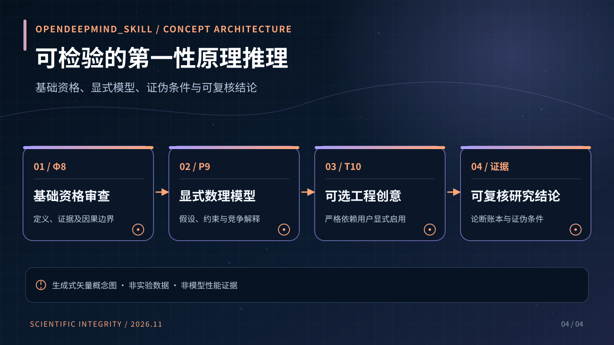
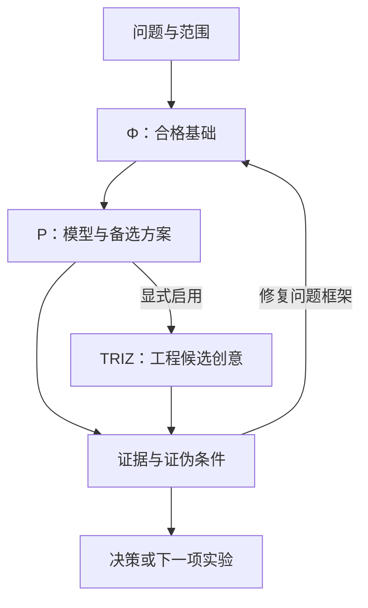

# OpenDeepMind_skill


**从清晰的问题出发，经由显式模型与可追溯证据，形成经得起检验的决策。**

[English](README.md) · [技能路由](open-deep-mind/SKILL.md) · [架构](open-deep-mind/ARCHITECTURE.md) · [模块注册表](open-deep-mind/MODULES.json) · [评测框架](BENCHMARK.md) · [更新记录](CHANGELOG.md)


*AI 生成艺术背景与精确的中文轮廓字形、数理符号共同构成愿景图。图中功能对应仓库合同；它是概念示意，不是实测结果。[图像来源与历史图集](docs/assets/README.md)。*

OpenDeepMind 是一个可移植的 Agent Skill，由三个隔离的推理模块组成。兼容 Agent Skills 的宿主提供语言模型；本仓库提供方法、结构化合同、上下文准备、证据结构检查，以及独立的行为评估框架。核心 Python 工具只使用标准库，CI 使用 Python 3.12。

本项目独立开发，与 Google DeepMind、OpenAI、Anthropic、MATRIZ、Altshuller Institute 及所引用仓库的维护者不存在隶属或背书关系。许可与版本见 [LICENSE.md](LICENSE.md)、[NOTICE.md](NOTICE.md) 和 [VERSION](VERSION)。

## 2026 年架构图：四阶段审查路径



以上为可编辑矢量概念图；功能状态以源码、测试及来源证据为准，图形不表示模型已运行或科研结论已获认证。

## 一、功能如何落到可检查的产物

| 组成 | 实际职责 | 源码或方法与输出 |
|---|---|---|
| 第一哲学，**Φ8 = Φ0…Φ7** | 审查定义、证据、因果承诺、边界、尺度与价值 | [规范方法](open-deep-mind/first-philosophy/METHOD.md)；基础章程 |
| 第一性原理，**P9 = P1…P9** | 分解需求、建立显式模型、比较备选方案、提出证伪条件 | [规范方法](open-deep-mind/first-principles/METHOD.md)；模型合同与决策记录 |
| TRIZ，**T10 = T1…T10** | 在显式启用后产生工程创意 | [规范路由](open-deep-mind/triz/ROUTER.md)；候选方案必须返回 P 验证 |
| 上下文准备 | 在字节预算内加载选定路线、源码身份和共享质量门禁 | [prepare_context.py](open-deep-mind/scripts/prepare_context.py)；`PREPARED_NOT_EXECUTED` 回执 |
| 论断账本 | 检查类型、引用、推理依赖与循环 | [validate_ledger.py](open-deep-mind/scripts/validate_ledger.py)；结构诊断 |
| 评估层 | 创建隔离迭代、校验执行与评分记录、聚合可比观测 | [评估脚本](open-deep-mind/evals/scripts/)；可审计 JSON 报告 |

评估层观察三个模块的行为，不是第四种推理方法，上下文准备 CLI 不会加载评测案例。数值求解器、实验仪器、模型 API 执行和独立科学认证由外部系统提供。



## 二、先运行检查，再提出清晰的问题

```bash
git clone https://github.com/SUNHAOJUN22/OpenDeepMind_skill.git
cd OpenDeepMind_skill
python open-deep-mind/scripts/validate_repository.py .
python open-deep-mind/scripts/validate_ledger.py open-deep-mind/assets/example-ledger.json
python open-deep-mind/scripts/prepare_context.py --route p --format manifest
```

按照宿主的技能发现机制加载 `open-deep-mind/`，以 [SKILL.md](open-deep-mind/SKILL.md) 为入口。准备上下文时明确选择路线：

```bash
python open-deep-mind/scripts/prepare_context.py --route phi --format markdown
python open-deep-mind/scripts/prepare_context.py --route phi-p --format json
python open-deep-mind/scripts/prepare_context.py --route triz --triz-requested --format manifest
```

`--route triz` 必须带有 `--triz-requested`，并包含用于后续概念验证的 P。默认预算为 256 KiB，包含来源标签；可用 `--max-bytes` 修改。资源缺失、启用条件不成立或预算不足时，在输出上下文之前失败。清单记录新计算的 SHA-256 与 UTF-8 字节数。准备阶段不执行模型，模型 token、质量、费用和模型延迟字段保持 null。

可交给宿主智能体的起始提示词：

```text
决策：选择能区分领先机理与强竞争机理的下一项计算或实验。
边界：明确系统、工况、时间尺度和排除的效应。
证据：关联原始观测，保留单位、不确定度和来源。
约束：列出硬限制、约束依据以及有权修订的人。
未知：列出可能改变决策的缺失信息。
过程：问题框架不稳时先用 Φ；再用 P 建模并挑战结论。
      将观测、规律、假设和经验闭合清楚地区分。
交付：类型化账本、显式模型、强竞争方案、证伪条件、可逆的下一步，
      以及复核触发条件。只有在我明确请求时才启用 TRIZ。
```

| 场景 | 建议路线 | 核心验收问题 |
|---|---|---|
| 目标、定义或因果框架尚不稳定 | Φ 后接 P | 基础是否足以支持后续模型？ |
| 边界与技术目标已经明确 | P | 单位、闭合、约束和证伪条件是否显式？ |
| 明确要求工程发明或概念探索 | TRIZ 后返回 P | 每个候选是否经过物理和证据检查？ |
| 比较技能的行为表现 | 独立评测框架 | 观测是否可复现，配对条件是否可比？ |

## 三、论断类型、引用图与数值边界

[论断模式](open-deep-mind/assets/claim-ledger.schema.json) 保留八种类型；兼容 API 接受下列代码或对应的英文全名。

| 代码 | 含义 | 必须保留的区别 |
|---|---|---|
| D | 定义 | 操作性含义，不是观测事实 |
| O | 观测 | 有来源的记录或测量 |
| L | 规律／不变量 | 在适用域内有支持的关系 |
| C | 约束 | 有权限依据与范围的边界或要求 |
| A | 假设 | 可修订的前提，带失效或敏感性条件 |
| E | 经验闭合／估计 | 有来源的拟合、学习或启发式关系 |
| V | 价值 | 利益相关方目标、偏好或规范承诺 |
| U | 未知 | 可能影响决策的未解决信息 |

将账本写成有向图 $G=(N,E)$，其中 $N$ 是论断与推理节点，$E$ 是引用边。这里的边集合 $E$ 与经验闭合的类型代码是不同含义。

$$
\forall(u,v)\in E:\ u,v\in N,\qquad G\text{ 无有向环}.
$$

迭代式校验器限制原始 JSON 为 8 MiB、嵌套深度为 128、记录数为 10,000、引用数为 100,000。重复 JSON 键、孤立 Unicode 代理字符、非有限数值，以及转成浮点数时下溢为零的非零数值都会被拒绝。精确零 `0e-999` 和可表示的次正规数 `5e-324` 仍须通过各字段自己的范围检查。 账本校验只接受身份稳定的普通文件：符号链接、目录、FIFO 和其他特殊文件会在解析前被拒绝；在 POSIX 上，文件以非阻塞、禁止跟随链接的方式打开，并与事先观察到的设备号和 inode 身份交叉核对。

可选置信度必须满足：

$$
c_i\in\mathbb R,\quad \operatorname{finite}(c_i),\quad 0\le c_i\le1.
$$

没有数值估计时省略 `confidence`；显式 null、布尔值与数值字符串无效。结构一致性不能证明论断为真；没有校准程序与相应数据，置信度也不能解释为经过校准的概率。

## 四、Python 代码实际执行的数理计算

执行入口为 [contracts_v17.py](open-deep-mind/scripts/contracts_v17.py) 和 [aggregate_benchmark.py](open-deep-mind/evals/scripts/aggregate_benchmark.py)。以下定义对应它们真实输出的量。

### 1. 槽位完整性与发布边界

评测槽位标识案例、配置和重复编号。对兼容辅助函数，设 $S$ 为非空且唯一的预期槽位集合，$n_s$ 为槽位 $s$ 的观测次数：

$$
C_{\mathrm{helper}}=\frac{\sum_{s\in S}\mathbf1[n_s=1]}{|S|}.
$$

缺失、重复和孤立槽位分别产生诊断；重复记录不会获得额外权重。本次优化将预期成员集合构造移到遍历之前，避免每检查一个观测身份就重新构造完整集合。大规模清单回归保留原判定，并采用确定性的哈希工作量预算验证复杂度，避免依赖波动的耗时阈值。

完整聚合器只有在执行记录与评分记录均通过检查后，才将一个槽位计入完整集合。记这些合法预期身份为 $S_{\mathrm{valid}}$：

$$
C_{\mathrm{aggregate}}=\frac{|S_{\mathrm{valid}}|}{|S|}.
$$

完整性为 1 也不能覆盖元数据错误、重复、孤立文件或其他阻断项。内部产物完整时返回 `ARTIFACT_SET_COMPLETE`，`publication_ready` 仍为 false。正式发布需要独立核验真实执行、原始证据、留出集封存、评分者身份与发布权限。

### 2. 断言、有效结论与可选指标

对于 $n$ 个布尔断言结果 $a_j$：

$$
p=\sum_{j=1}^{n}\mathbf1[a_j=\mathrm{true}],\qquad f=n-p,\qquad
r_a=\begin{cases}p/n,&n>0,\\0,&n=0.\end{cases}
$$

报告的数量与通过率必须和明细一致；通过率一致性绝对容差为 $10^{-12}$。断言文本去除首尾空白后必须唯一，通过的断言需要非空回答证据。案例通过还要求所有断言通过，且没有红色阻断项、报告的模块泄漏或禁止的 TRIZ 激活。聚合通过率与成对胜负使用相同的有效结论：

$$
\widehat P=\frac1N\sum_{i=1}^{N}\mathbf1[\operatorname{effective\_pass}_i].
$$

路由与 TRIZ 误激活还会检查记录的路线和模块元数据。强制路由消融不计入生产路由准确率。语义判断仍需要实质性评分。

成对比较必须区分共同候选身份集合 $I_0$ 与条件可比、被接受的配对集合 $I$。模型或版本不一致、`execution_conditions` 缺失或不同都会排除候选。双方同样缺失版本时计入 `unversioned_paired_runs`，不构成独立版本证明。

$$
I\subseteq I_0,\qquad I_z=\{i\in I:\ z_{L,i},z_{R,i}\text{ 均有记录}\},\qquad
\overline{\Delta z}=\frac1{|I_z|}\sum_{i\in I_z}(z_{L,i}-z_{R,i}).
$$

`candidate_paired_runs` 对应 $|I_0|$，`paired_runs` 对应 $|I|$。可选指标可能使用更少的配对；$I_z$ 为空时输出 null，不用零补齐。被排除配对中的合法单次观测仍予保留。盲法成对判断是单独的证据产物。

对已排序的实际观测 $z_{(1)}\le\cdots\le z_{(n)}$，分布辅助函数采用最近秩分位数：

$$
Q_p=z_{(\lceil pn\rceil)},\qquad p\in\{0.50,0.95\},\ n>0.
$$

空样本返回数量 0 与 null 分位数。token 数和耗时使用非布尔整数，上限为 $2^{53}-1$。费用用百万分之一货币单位的整数记录，并保留币种、计费依据和价格快照身份；只有这些身份一致时才计算费用差。详见[费用记录合同](open-deep-mind/evals/README.md#cost-and-latency-records)。

[语义评分规范](open-deep-mind/evals/rubric.md) 有十个带锚点的维度，$s_k\in[0,5]$，权重合计 100，其合同为：

$$
Q=\sum_{k=1}^{10}w_k\frac{s_k}{5},\qquad \sum_{k=1}^{10}w_k=100.
$$

兼容辅助函数 `weighted_behavior_score` 对完整的归一化槽位分数计算等权平均：

$$
B=\frac1N\sum_{i=1}^{N}b_i,\qquad 0\le b_i\le1.
$$

覆盖不完整时不输出分数；重复预期身份、非法／非有限／布尔分数被拒绝。不能将 0–100 的评分规范分值直接传入这个归一化辅助函数。

## 五、科学任务中的数理建模合同

以下关系是 [P9 方法](open-deep-mind/first-principles/METHOD.md) 与[模型模式](open-deep-mind/first-principles/model-contract.schema.json)支持的推理模板，用于指导外部求解或分析；技能本身不数值求解这些方程。必须记录变量、单位、参数及来源、约束、闭合、初边值条件、观测误差、适用域和证伪条件。

### 1. 可行决策与显式目标

$$
\mathcal X_f=\{x:h(x)=0,\ g(x)\le0\},\qquad
x^\star\in\operatorname*{arg\,min}_{x\in\mathcal X_f}J(x;V).
$$

$x$ 为决策向量，$h,g$ 为等式与不等式约束，$J$ 为目标函数，$V$ 记录价值承诺。先排除违反硬约束的方案，再进行偏好评分；适用时保留强竞争方案和暂不行动选项。

### 2. 动力学、守恒与观测

$$
\dot{\mathbf x}=\mathbf f(\mathbf x,\mathbf u,\boldsymbol\theta,t),\qquad
\frac{\partial q}{\partial t}+\nabla\cdot\mathbf J_q=s_q.
$$

状态 $\mathbf x$、控制 $\mathbf u$、参数 $\boldsymbol\theta$、守恒密度 $q$、通量 $\mathbf J_q$ 和源项 $s_q$ 都需要一致的单位与明确适用域。通过观测算子连接测量：

$$
\mathbf y=\mathcal H(\mathbf x,\boldsymbol\theta)+\boldsymbol\epsilon.
$$

说明 $\boldsymbol\epsilon$ 是仪器噪声、模型差异还是二者之和。检查极限情况、守恒、数值收敛、敏感性和可辨识性。复现校准数据本身不是独立验证。

### 3. 证据更新、尺度桥接与干预

$$
p(\theta\mid y)\propto p(y\mid\theta)p(\theta),\qquad
z=\mathcal C(x),\qquad y_{\mathrm{macro}}=\mathcal M(z;\eta).
$$

贝叶斯更新需要有依据的先验与似然；跨尺度关系需要映射 $\mathcal C$、闭合参数 $\eta$、不确定度、丢失的信息与验证域。分子层结果不能单独证明工艺尺度性能。

$$
X_i=f_i(\operatorname{Pa}_i,U_i),\qquad
P(Y\mid X=x)\ne P(Y\mid\operatorname{do}(X=x))\text{ 一般成立}.
$$

在将关联提升为因果结论之前，需要因果识别论证或能区分竞争机理的干预。

### 4. 如何选择下一项有区分力的研究

对研究设计 $d$、未来观测 $Y$、不确定状态 $\theta$、可行动作 $\mathcal A$ 与效用 $U$，P9 的样本信息期望价值为：

$$
\operatorname{EVSI}(d)=
\mathbb E_{Y\mid d}\!\left[\max_{a\in\mathcal A}\mathbb E_{\theta\mid Y,d}U(a,\theta)\right]
-\max_{a\in\mathcal A}\mathbb E_\theta U(a,\theta).
$$

先依据后验期望效用选动作，再对可能的观测取平均。在可行动作相同、效用模型不变且允许忽略观测时：

$$
0\le\operatorname{EVSI}(d)\le\operatorname{EVPI},\qquad
\operatorname{EVPI}=\mathbb E_\theta\max_{a\in\mathcal A}U(a,\theta)
-\max_{a\in\mathcal A}\mathbb E_\theta U(a,\theta).
$$

P9 的二元决策示例中，独立公平比特的 EVSI 为 0，正确率 75% 的观测为 0.25，完美观测为 0.5。这些是有限状态的示意效用计算，不是实测模型分数。应在相容的效用单位下扣除获取、延迟和实施成本；先验、似然或效用无法得到支持时，保留决策不确定性。

## 六、执行可复现的评测流程

编写的案例集共有 60 例，固定分为 36 个训练、12 个验证、12 个留出案例，每项设计重复 3 次。四种配置分别是不加载技能、固定提交的外部第一性原理基线、完整技能和禁用 TRIZ 的消融。验证设计共 114 个槽位：12 案例 × 3 配置 × 3 次，加上 2 个显式 TRIZ 案例 × 3 次消融。这是设计数量，不是已执行模型次数。

```bash
python open-deep-mind/evals/scripts/validate_evals.py
python open-deep-mind/evals/scripts/create_workspace.py --iteration 1 --split validation --workspace ../OpenDeepMind_skill-workspace
```

创建过程原子发布完整迭代，目标已存在时拒绝覆盖。使用有授权的外部执行器填充预期的 `run_record.json`、原始回答和 `grading.json`。保留模型与版本、采样／推理设置、工具权限、输入身份、仓库版本、重复设计与评分证据；不得将留出案例转为运行时指令。

填入真实记录后再聚合：

```bash
python open-deep-mind/evals/scripts/aggregate_benchmark.py ../OpenDeepMind_skill-workspace/iteration-1
```

默认报告为 `benchmark.json`。空迭代或不完整迭代不能认证完整结果。自定义 `--output` 不得覆盖 `manifest.json` 或任何 `eval-*` 证据目录内的文件，包括父目录别名所指向的证据路径。这是写入前的路径检查，不能防御并发文件系统变化。参见[评测文档](open-deep-mind/evals/README.md)与[修复／迁移说明](docs/acceptance-repair.md)。

## 七、验收、排障与使用策略

在仓库根目录运行全部维护中的软件门禁：

```bash
python open-deep-mind/scripts/validate_repository.py .
python open-deep-mind/scripts/validate_ledger.py open-deep-mind/assets/example-ledger.json
python open-deep-mind/first-philosophy/scripts/validate_module.py
python open-deep-mind/first-principles/scripts/validate_module.py
python open-deep-mind/triz/scripts/validate_triz_module.py
python open-deep-mind/evals/scripts/validate_evals.py
python open-deep-mind/triz/scripts/lookup_matrix.py --improve 1 --worsen 3 --json
python open-deep-mind/triz/scripts/lookup_standard_solution.py 1.2.1 --json
python -m unittest discover -s open-deep-mind/tests -p 'test_*.py'
python -m compileall -q open-deep-mind
git diff --check
```

[CI](https://github.com/SUNHAOJUN22/OpenDeepMind_skill/actions/workflows/validate.yml) 还会拒绝生成物或源码漂移。[七仓库验收工作流](https://github.com/SUNHAOJUN22/TsaoSciResearcher/actions/workflows/six-repository-acceptance.yml) 负责长时软件回归；只有绑定提交上的完整回执才能证明六小时执行，本文不预先宣告该结果或行为分数。

| 现象 | 处理方式 |
|---|---|
| TRIZ 激活被拒绝 | 确认用户显式请求／接受，再传递声明；不从关键词猜测授权。 |
| 上下文超出预算 | 选择足够的路线并渐进加载相关资源，保留质量门禁。 |
| 账本或 JSON 被拒绝 | 按诊断修正具体类型、数值范围、引用或循环。 |
| 配对数小于候选数 | 检查 `excluded_pairs`、模型／版本和执行条件。 |
| 指标为 null | 补齐缺失观测，不把缺失视为零。 |
| 产物完整但尚无发布资格 | 补充独立执行、评分、留出集与发布证据。 |

从一个可追溯模型和一个强竞争模型开始，选择足够轻的路线；每项重要结果绑定单位与证据，保留红色阻断项，并选择能改变决策的最小可逆行动。[质量门禁](open-deep-mind/references/quality-gates.md)、[账本模板](open-deep-mind/assets/claim-ledger-template.md)与[决策模式](open-deep-mind/first-principles/decision-record.schema.json)使这些要求可被复核。
